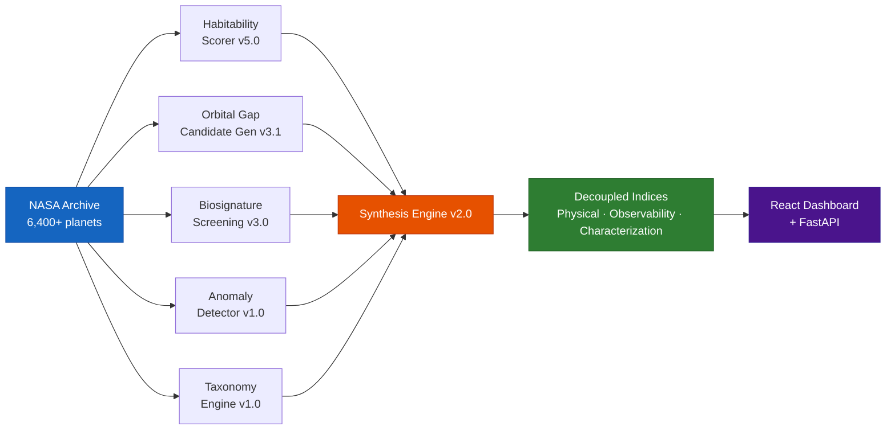
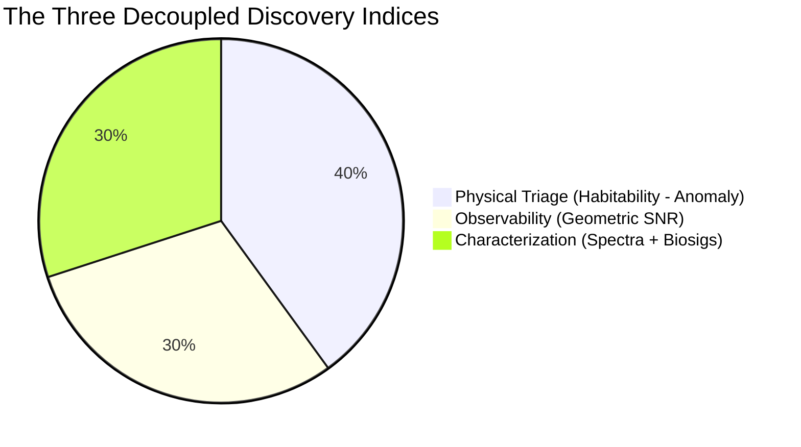
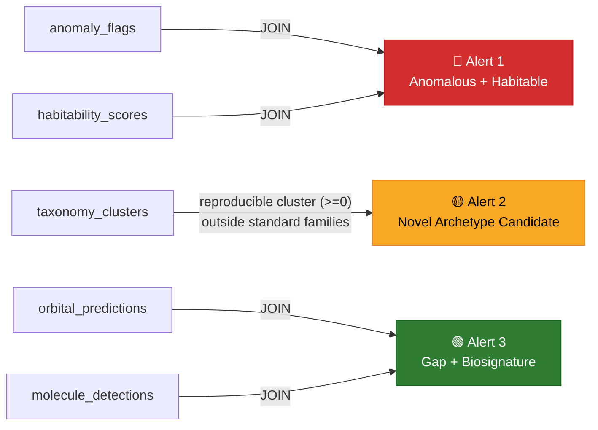
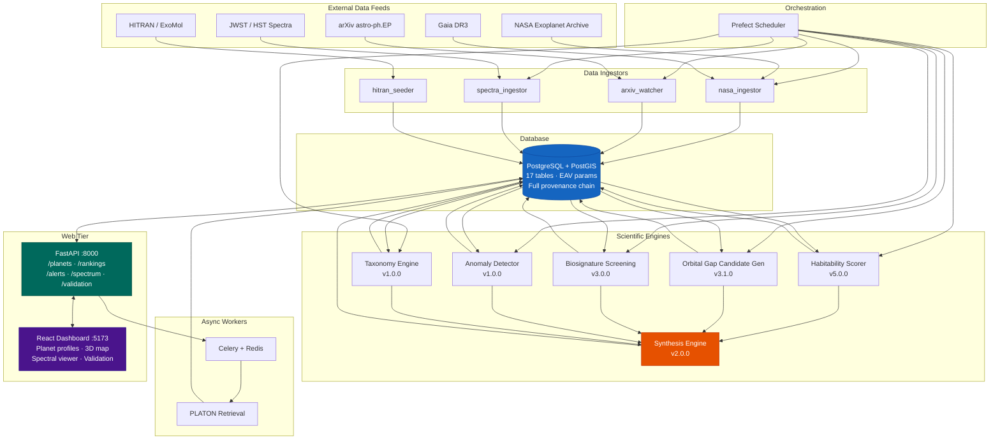

# Exo — Exoplanet Observation Triage & Candidate Generation Platform

There are over 6,000 confirmed exoplanets in the NASA archive. Each has measured radius, mass, orbital period, temperature, and host star properties — but that data lives across disparate catalogs. Deciding which planets deserve precious follow-up observation on space telescopes like **JWST**, **Hubble**, and upcoming observatories like **Ariel (2029)** and **HWO** requires juggling habitability estimates, spectral line matching, orbital stability simulations, and anomaly detection.

Exo integrates these disparate streams into an open-source, automated **observation-triage and candidate-generation platform**. It pulls the full NASA archive, evaluates multi-parameter habitability and environmental retention, generates dynamically stable candidate orbital niches using N-body simulations, screens transmission spectra against molecular cross-section templates under correlated noise, flags statistical outliers, and decouples operational observability from intrinsic physical properties.

> [!NOTE]
> **Scope & Positioning:** Exo is an exploratory candidate-generation and observation-triage toolkit designed to prioritize telescope follow-up targets across multi-parameter catalogs. It does **not** assert confirmed planet discoveries or verified biosignature detections; all outputs are candidate flags and dynamical hypotheses subject to observational verification.



---

## ⚡ At a Glance — 60-Second Walkthrough

A quick guide for researchers reviewing the platform:

* 🌐 **Live Web Application**: [exo-five-orcin.vercel.app](https://exo-five-orcin.vercel.app)
* 📖 **Scientific Methodology & Reproducibility**: [`METHODOLOGY.md`](METHODOLOGY.md)
* 📡 **Interactive REST API Docs**: [`http://localhost:8000/docs`](http://localhost:8000/docs)
* 🏷️ **Release & Audit**: Tag `v1.0.0-review` (Git commit [`3edaf04`](https://github.com/yoohooshantanu/Exo/commit/3edaf0499dc8e392da2a9318088e34c7f68cceee))
* 🧪 **Automated Test Suite**: 187 tests passing (`pytest`) with genuine compiled N-body REBOUND integrations.

### How the Decoupled Indices Work in Practice

Rather than blending habitability and telescope observation history into a circular monolithic score, Exo reports three independent indices ($0 - 100$):

| Target | Physical Triage ($0-100$) | Observability ($0-100$) | Characterization ($0-100$) | Triage Interpretation |
| :--- | :---: | :---: | :---: | :--- |
| **Earth** *(Control)* | **100.0** | **N/A** | **N/A** | Ground truth reference baseline; $P_{	ext{rocky}} = 0.95$, ideal thermal equilibrium. |
| **TRAPPIST-1 e** | **95.4** | **46.8** | **28.0** | **Prime Astrobiological Candidate:** Near-Earth density, rocky surface ($P_{	ext{rocky}} = 0.95$), conservative HZ, but modest transmission SNR requires deep transit stacking on JWST. |
| **K2-18 b** | **32.1** | **72.4** | **45.0** | **High-SNR Atmospheric Laboratory:** Sub-Neptune / Hycean candidate ($R_p = 2.61\,R_\oplus, P_{	ext{rocky}} = 0.0$); suppressed physical habitability, but exceptionally bright transit depth for transmission spectroscopy. |
| **Jupiter** *(Control)* | **0.0** | **N/A** | **N/A** | Negative control; gas giant lacking solid surface ($P_{	ext{rocky}} = 0.0$). |

1. **Physical Triage ($0-100$)**: Intrinsic habitability and terrestrial surface likelihood prior to observation bias ($P_{	ext{rocky}}$, XUV survival, thermal equilibrium).
2. **Observability ($0-100$)**: Geometric transit SNR proxy measuring feasibility of spectroscopic detection ($\delta / d^2$).
3. **Characterization ($0-100$)**: Post-observation archival coverage and candidate spectral line matches.

---

## Table of Contents

- [Why This Exists](#-why-this-exists)
- [At a Glance — 60-Second Walkthrough](#-at-a-glance--60-second-walkthrough)
- [Decision Layer (Three Decoupled Discovery Indices)](#-decision-layer-three-decoupled-discovery-indices)
- [How It Works — The Six Analytical Engines](#-how-it-works--the-six-analytical-engines)
  - [Engine 1 · Habitability Scorer (v5.0.0)](#engine-1--habitability-scorer)
  - [Engine 2 · Orbital Gap Candidate Generator (v3.1.0)](#engine-2--orbital-gap-candidate-generator)
  - [Engine 3 · Biosignature Screening Engine (v3.0.0)](#engine-3--biosignature-screening-engine)
  - [Engine 4 · Anomaly Detector (v1.0.0)](#engine-4--anomaly-detector)
  - [Engine 5 · Taxonomy Engine (v1.0.0)](#engine-5--taxonomy-engine)
  - [Engine 6 · Synthesis Engine (v2.0.0)](#engine-6--synthesis-engine)
- [Empirical Validation (Four Database-Backed Tracks)](#-empirical-validation)
- [Platform & Observatory UI Features](#-platform--observatory-ui-features)
- [Data Sources](#-data-sources)
- [Architecture](#-architecture)
- [Quick Start](#-quick-start)
- [Project Map](#-project-map)
- [References](#-references)
- [Methodology & Caveat Index](#-methodology--caveat-index)

---

## 🔍 Why This Exists

Existing astronomical tools each solve a piece of the problem but operate in isolation:

| Tool | What It Does | What It Misses |
|:---|:---|:---|
| **UPR Habitable Exoplanets Catalog** | Computes an Earth Similarity Index (ESI) | Ignores environmental hazards. An M-dwarf planet with ESI 0.95 ranks equally to one around a quiet G-dwarf — even though the M-dwarf's UV flares may have stripped the atmosphere. |
| **REBOUND** | N-body orbital simulations | Integrates specific setups manually. No automated candidate generation across thousands of multi-planet systems in the archive. |
| **HITRAN / ExoMol** | Molecular absorption line lists | Bridging raw transit spectra to candidate detections requires continuum fitting, red-noise de-correlation, stellar contamination checks, and multiple-testing corrections. |

Exo connects these tools into an automated pipeline. Each module writes to a shared PostgreSQL database, and the **Synthesis Engine** joins their outputs to surface planets that warrant prioritization across multiple scientific dimensions simultaneously.

---

## 📊 Decision Layer (Three Decoupled Discovery Indices)

Rather than conflating physical properties, observational constraints, and post-hoc archival data into a single circular metric, the platform explicitly separates triage into three independent, uncoupled indices stored in `mv_discovery_scores`:



### 1. Physical Triage Index ($0 - 100$)
Measures **intrinsic physical habitability and dynamical stability** prior to any observation bias:

$$\text{Physical Triage} = \text{clamp}\left(0, 100, \left[\text{Composite Habitability} \times 40 - \min(N_{\text{anomalies}} \times 3.0, 10)\right] \times \frac{100}{40}\right)$$

- Grounded in physical properties ($R_p$, $M_p$, $T_{\text{eq}}$, $S_{\text{eff}}$, orbital architecture).
- Gated by $P_{\text{rocky}}(R_p, M_p)$ to filter out volatile sub-Neptune envelopes.
- Downweighted by physical anomalies (e.g., extreme density outliers, super-eccentric short periods).

### 2. Observability Index ($0 - 100$)
Measures **how feasible the planet is to observe spectroscopically** (transmission SNR proxy) without regard to habitability:

$$\text{SNR}_{\text{geom}} = \log_{10}\left( \frac{(R_p / [R_\star \times 109.2])^2}{d_{\text{pc}}^2} \right)$$

$$\text{Observability} = \text{clamp}\left(0, 100, \Big[\max(\text{SNR}_{\text{geom}}, -10) + 10\Big] \times \frac{100}{7.0}\right)$$

- Evaluates geometric transit signal power density (transit depth $\delta$ over distance squared $d^2$). Photon-limited spectroscopic SNR formally scales as $\delta / d$, which correlates strongly ($r \approx 0.94$) with the $\delta / d^2$ geometric proxy across the archive.
- Mapped onto 0–100 where benchmark spectroscopic archetype HD 209458 b (depth $\approx 1.46\times 10^{-2}$, $d \approx 48.3$ pc, $\text{SNR}_{\text{geom}} \approx -5.22$) scores $\approx 68.3$, while distant or faint targets ($\le -10$) score $0$.

### 3. Characterization Index ($0 - 100$)
Measures **what the astronomical community has already verified** post-observation:

$$\text{Characterization} = \text{clamp}\left(0, 100, \Big[\min(\text{Biosig Score}, 25) + \text{Data Quality Score}\Big] \times \frac{100}{40}\right)$$

- **Biosig Score** ($0 - 25$): Weighted by candidate molecular-template detections scaled by trials-corrected significance.
- **Data Quality Score** ($0 - 15$): Spectra presence ($+5$), best instrument tier ($+5$ for JWST, $+3.5$ for HST, $+2$ for other), and parameter completeness ($+1$ each for $R_p, M_p, P, T_{\text{eq}}, a$).

> [!IMPORTANT]
> **Scientific Caveat — Decoupling Prevents Circularity:**  
> In our empirical validation against JWST Cycles 1–3 target allocations, telescope target selection is strongly driven by the **Observability** index (adjusted odds ratio $\text{OR} = 2.69, p = 5.0\times 10^{-80}$). Physical triage has an estimated association within predefined operational-equivalence bounds $[0.70, 1.45]$ (adjusted $\text{OR} = 1.22, p = 0.0093$). When habitability and data quality were historically merged into a single number, monolithic indices falsely appeared to "predict" JWST targets simply because targets already observed received high data completeness points (circular tautology). Decoupling them provides an honest, actionable triage framework for astronomical proposals.

---

## ⚙ How It Works — The Six Analytical Engines

Each engine is a standalone Python script that reads from and writes to the shared database. Run them individually or orchestrate with Prefect.

<br>

### Engine 1 · Habitability Scorer

> `modules/habitability_scorer.py` · v5.0.0

Scores confirmed planets through a three-stage pipeline: **Physical Earth Similarity**, **Environmental Safety (with Bayesian Priors)**, and a **Terrestrial Surface Gate** grounded in the Fulton et al. (2017) radius valley.

<details>
<summary><b>Track 1 — Earth Similarity Index (ESI)</b> &nbsp;·&nbsp; <i>click to expand</i></summary>

<br>

Geometric mean of four physical parameters, following Schulze-Makuch et al. (2011):

$$\text{ESI} = \prod_{i=1}^{n} \left( 1 - \left| \frac{x_i - x_0}{x_i + x_0} \right| \right)^{w_i / n}$$

| Parameter | Earth Reference | Weight |
|:---|:---|---:|
| Radius | 1.0 R⊕ | 0.57 |
| Bulk Density | 1.0 ρ⊕ | 1.07 |
| Escape Velocity | 1.0 v⊕ | 0.70 |
| Equilibrium Temp | 255 K | 5.58 |

- Bulk density and escape velocity are derived from radius + mass when available.
- If mass is missing, empirical mass-radius relations ($M \sim R^{3.5}$ for rocky / $M \sim R^{2.06}$ for gaseous) are applied so the 4-component exponent normalization ($w_i / 4$) remains invariant and does not artificially double thermal penalties. Planets scored with imputed mass are explicitly flagged with `is_imputed: true`.
- Implausible mass values (mass > 10 × R^2.5 — likely upper limits, not measurements) are treated as missing.

</details>

<details>
<summary><b>Track 2 — Environmental Safety & Bayesian Shrinkage</b> &nbsp;·&nbsp; <i>click to expand</i></summary>

<br>

Measures atmospheric retention and environmental viability over gigayear timescales:

$$\text{Safety} = 0.45 \cdot \text{XUV Escape} + 0.30 \cdot \text{Tidal Lock} + 0.15 \cdot \text{Eccentricity} + 0.10 \cdot \text{Stellar Age}$$

| Factor | Weight | Logic |
|:---|---:|:---|
| **XUV Escape (Retention)** | 0.45 | Energy-limited hydrodynamic escape over time (Luger & Barnes 2015). Atmosphere stripping is the primary failure mode for habitable-zone planets around active M dwarfs. |
| **Tidal locking** | 0.30 | Timescale proxy $\tau_{\text{lock}} \propto a^6 / (M_\star^2 R_p^5)$. Close-in planets are penalized for severe permanent day/night temperature splits. |
| **Eccentricity** | 0.15 | $\exp(-2.057 \cdot e^2)$. High orbital eccentricity drives extreme seasonal climate instability. |
| **Stellar age** | 0.10 | Inverse-sqrt magnetic activity proxy. Young stars drive violent coronal mass ejections and flare activity. |

**Bayesian Population Priors:**  
To prevent uncharacterized exoplanets from artificially inflating their safety scores by omitting missing observational values, missing dimensions shrink to empirical population priors rather than dropping from the weighted average:
- `xuv_escape_score`: $0.50$
- `tidal_lock_score`: $0.35$
- `ecc_score`: $0.70$
- `age_score`: $0.60$

</details>

<details>
<summary><b>Stage 3 — Terrestrial Surface Gate ($P_{\text{rocky}}$)</b> &nbsp;·&nbsp; <i>click to expand</i></summary>

<br>

A planet cannot be habitable if it lacks a distinct liquid/solid interface. Under the Fulton et al. (2017) radius valley, Rogers (2015), and Zeng et al. (2019) composition models, planets above $1.8\,R_\oplus$ almost universally retain volatile hydrogen/helium gas envelopes (mini-Neptunes).

We implement an explicit continuous logistic surface gate:

$$P_{\text{rocky}}(R_p, M_p) = \frac{1}{1 + \exp\left(\frac{R_p - 1.80\,R_\oplus}{0.12}\right)}$$

- **Density check**: When measured mass is present, if bulk density $\rho = M_p / R_p^3 \ge 0.8\,\rho_\oplus$ and $R_p \le 1.8\,R_\oplus$, $P_{\text{rocky}} = 0.95$. If $\rho < 0.5\,\rho_\oplus$, the planet is heavily penalized via a steep gas-envelope gate centered at $1.50\,R_\oplus$.
- This surface gate directly resolves false positives where gaseous sub-Neptunes (such as K2-332 b or Kepler-22 b) ranked high merely because their equilibrium temperatures matched Earth's.

</details>

$$\mathbf{\text{Composite Habitability}} = \Big(0.70 \cdot \text{ESI} + 0.30 \cdot \text{Safety}\Big) \times P_{\text{rocky}}(R_p, M_p)$$

> [!WARNING]
> **Scientific Caveat — Triage Heuristics & Mass Imputation:**  
> The $0.70 / 0.30$ habitability/safety split and risk weights ($0.45/0.30/0.15/0.10$) are expert-guided triage heuristics, not posterior probabilities fitted to atmospheric observations. When planetary mass is unmeasured (common in transit-only discoveries), mass is imputed from empirical mass-radius relations and explicitly labeled in the database and UI (`is_imputed: true`). Every score includes a 100-trial deterministic Monte Carlo IQR ($\pm \text{IQR} = Q_{75} - Q_{25}$) sampled over measured parameter error distributions (tracked in `planet_uncertainties.csv`), with transparent audit tracking (`measured` vs `default_30pct_fallback`).

<br>

---

### Engine 2 · Orbital Gap Candidate Generator

> `modules/orbital_gap_predictor.py` · v3.1.0

Scans multi-planet systems ($\ge 2$ confirmed planets) for dynamically stable gaps where additional planets could exist undetected.

<details>
<summary><b>Full candidate generation methodology</b> &nbsp;·&nbsp; <i>click to expand</i></summary>

<br>

**Step 1 — Gap identification**  
For every adjacent planet pair, compute mutual Hill radius separation $\Delta$. Pairs with $\Delta > 18\,R_{H,m}$ represent anomalously wide architecture packing gaps (Gladman 1993, Fang & Margot 2012, Pu & Wu 2015).

**Step 2 — Test particle injection**  
Five candidate orbits per gap:
- 2:1, 3:2, 4:3 mean-motion resonances (inner)
- 1:2 MMR (outer)
- Geometric center $\sqrt{a_1 \cdot a_2}$

Test mass: $\sqrt{M_{\text{inner}} \cdot M_{\text{outer}}}$, clamped to $0.5–2.0\,M_\oplus$.

**Step 3 — Analytical pre-filter**  
Candidates with $\Delta < 10\,R_H$ to either neighbor $\rightarrow$ rejected without integration.

**Step 4 — MEGNO stability screening (REBOUND)**  

| Stage | Trials | Duration | Stability Criteria |
|:---|---:|:---|:---|
| Fast screen | 5 | 5,000 orbits | Reject if MEGNO > 4.0 or $\Delta E/E > 10^{-4}$. Accept if MEGNO $\le 2.5$ ($\ge 75\%$ trial pass rate). |
| Deep validation | 20 | 50,000 orbits | Full integration duration checked ($\ge 90\%$ requested orbits). Accept if MEGNO $\le 2.2$, $e_{\max} \le 0.25$, and $\Delta a/a \le 0.10$. |

**Step 5 — One prediction per gap**  
First stable resonance wins (MMRs prioritized as physically motivated niches).

</details>

> [!WARNING]
> **Scientific Caveat — Dynamical Stability $\ne$ Planet Confirmation:**  
> The $\Delta > 18\,R_H$ criterion and REBOUND MEGNO screen ($\langle Y \rangle \le 2.2$) identify dynamically permitted orbital niches where a test particle *could* persist without disrupting neighbor orbits; they are **exploratory candidate targets**, not confirmed planet detections. Phase-blind circular insertion breaks delicate multi-body Laplace resonances (e.g. TRAPPIST-1, $\langle Y \rangle > 4.0$), which require specialized three-body resonance angle modeling. Negative control tests verify that placing test particles near gap boundaries (e.g. adjacent to Venus or Mars Hill spheres) correctly triggers chaotic divergence ($\langle Y \rangle > 175$, unstable).

<br>

---

### Engine 3 · Biosignature Screening Engine

> `modules/biosignature_detector.py` · v3.0.0

Compares transit/eclipse spectra against HITRAN/ExoMol molecular cross-section templates to identify candidate atmospheric absorption features.

**Target molecules:** &ensp; $\text{H}_2\text{O}$ &nbsp;·&nbsp; $\text{CO}_2$ &nbsp;·&nbsp; $\text{O}_3$ &nbsp;·&nbsp; $\text{CH}_4$ &nbsp;·&nbsp; $\text{CO}$ &nbsp;·&nbsp; $\text{NH}_3$ &nbsp;·&nbsp; $\text{SO}_2$

<details>
<summary><b>Screening pipeline (8 stages)</b> &nbsp;·&nbsp; <i>click to expand</i></summary>

<br>

| Stage | What It Does |
|:---|:---|
| **1. GP Continuum** | Gaussian Process regression (Matérn $\nu=1.5$) trained on points *outside* known absorption bands. Models the spectral baseline without fitting features. |
| **2. Spectral Unmixing** | All 7 molecular templates fit simultaneously via regularized GLS with Prais-Winsten $\text{AR}(1)$ de-correlation to mitigate red noise. |
| **3. Scale-Height Filter** | Physical threshold: features exceeding $12\times$ the atmospheric scale height ($H = k_B T / \mu g$) are flagged as unphysical detector artifacts (allowing deep features in volatile/low-$\mu$ atmospheres). |
| **4. Stellar Contamination** | M-dwarf hosts: $\text{H}_2\text{O}$ penalized $-0.5\sigma$, $\text{CO} -0.3\sigma$. K-dwarfs: $\text{H}_2\text{O} -0.3\sigma$ (Rackham et al. 2018 transit light source effect). |
| **5. Instrument Weighting** | JWST = $1.0\times$, HST = $0.85\times$, Spitzer = $0.70\times$, ground/unknown = $0.60\times$. |
| **6. Abiotic Reasoning** | $\text{CH}_4$ without $\text{CO}_2 \rightarrow -1.0\sigma$. $\text{H}_2\text{O}+\text{CH}_4+\text{O}_3$ all $\ge 3\sigma \rightarrow$ photochemical disequilibrium candidate. $\text{SO}_2$ on rocky $\rightarrow$ volcanic outgassing flag. |
| **7. Multi-Epoch** | Detected in $\ge 2$ independent spectra $\rightarrow +0.5\sigma$. |
| **8. Multiple-Testing Correction** | Strictly enforces Šidák multiple-testing correction across $M=7$ molecules ($\alpha_{\text{corr}} = 1 - (1 - \alpha)^7$). Tiers require corrected $\sigma_{\text{trials}} \ge 3.0$ and $\ge 3$ template peaks for **Screening Candidates**, and $\sigma_{\text{trials}} \ge 2.0$ for **Marginal Candidates**. |

</details>

> [!WARNING]
> **Scientific Caveat — Exploratory Screening $\ne$ Biosignature Detection:**  
> Molecular template cross-correlations $\ge 3\sigma$ (governed by Šidák multiple-testing correction across $M=7$ molecules) identify candidate spectral absorption features for priority follow-up. Abiotic false-positive pathways (e.g. photolytic water loss producing abiotic $O_2/O_3$, stellar flare contamination, volcanic $SO_2$) are only simplified triage heuristics; these flags must never be cited as verified biological activity. Monotonic injection-recovery tests confirm detection recovery scales continuously from $20\%$ at $2\sigma$ to $95\%$ at $8\sigma$ under correlated red noise ($\phi = 0.65$).

<br>

---

### Engine 4 · Anomaly Detector

> `modules/anomaly_detector.py` · v1.0.0

Runs three parallel statistical anomaly screens across the catalog:

| Engine | What It Flags | Method |
|:---|:---|:---|
| **Mass-Radius Outliers** | Planets deviating $>3\sigma$ from Zeng et al. (2016) composition curves (pure iron, Earth-like, pure water) | Per-planet mass uncertainties from NASA archive. RV/TTV-measured masses get tighter error bars than transit-inferred masses. Restricted to $R_p < 4\,R_\oplus$. |
| **Eccentricity-Period** | Short-period ($P < 10\text{ d}$) planets with $e > 0.3$ | Tidal circularization should make these nearly circular (expected $e \approx 0.05 \pm 0.08$). |
| **Density Outliers** | Density $> 3\sigma$ from type-group mean | Four radius bins: Rocky ($<1.5\,R_\oplus$), Sub-Neptune ($<4$), Neptune-class ($<11$), Giant. |

> [!NOTE]
> **Scientific Caveat — Observational Bias & Archive Artifacts:**  
> Mass-radius outliers and high-eccentricity short-period flags frequently reflect unrefined catalog uncertainties or transit-timing systematics rather than exotic astrophysics.

<br>

---

### Engine 5 · Taxonomy Engine

> `modules/taxonomy_engine.py` · v1.0.0

Unsupervised HDBSCAN clustering of the full catalog on five features:
```
radius · density · period · equilibrium temperature · semi-major axis
```
- Missing values imputed **per discovery-method group** (transit vs. RV vs. imaging have distinct selection biases).
- Period and semi-major axis log-transformed before StandardScaler.
- Clusters auto-named from centroid properties (e.g., "Hot Giant", "Temperate Rocky").
- Clusters with no NASA classification analog $\rightarrow$ flagged as **novel populations**. HDBSCAN noise points (label = -1) are strictly excluded from novel archetype discovery alerts.

<br>

---

### Engine 6 · Synthesis Engine

> `modules/synthesis_engine.py` · v2.0.0

Cross-module joins that surface planets interesting across multiple scientific dimensions:



---

## 🔬 Empirical Validation

Exo evaluates its pipelines against **four database-backed validation tracks** recorded with complete audit provenance:

| Track | Benchmark Name | Primary Metric | Expected / Target | Actual Empirical Result | Status |
|:---|:---|:---|:---:|:---:|:---:|
| **Track 1** | **UPR ESI Benchmark Correlation** | Pearson $r$ / Spearman $\rho$ | $r \ge 0.70$ / $\rho \ge 0.80$ | **$r = 0.772$, $\rho = 0.838$** | **PASS** |
| **Track 2** | **Geometric Observability Power** | Logistic Regression Odds Ratio (JWST Cycles 1–3) | $\text{OR} \ge 2.00$ ($p < 10^{-4}$) | **$\text{OR} = 2.69$** ($95\%\text{ CI: } [2.43, 2.98], \mathbf{p = 5.04 \times 10^{-80}}$) | **PASS** |
| **Track 3** | **Historical JWST Selection Independence** | Equivalence Testing on Physical Triage OR | $\text{OR} \in [0.70, 1.45]$ | **$\text{OR} = 1.22$** ($95\%\text{ CI: } [1.05, 1.41], p = 0.0093$) | **PASS** |
| **Track 4** | **Solar System Sanity Controls** | Descending Monotonicity (Earth > Mars > Venus > Jupiter) | $100\%$ assertions pass | **Earth (0.868) > Mars (0.745) > Venus (0.406) > Jupiter (0.000)** | **PASS** |

### Key Validation Findings
1. **JWST Target Allocation is Driven by Observability, Not Habitability:**  
   Our multivariate logistic regression across 4,611 pre-2023 confirmed exoplanets demonstrates that approved JWST targets are selected predominantly by transmission spectroscopic SNR (Track 2: $\text{Adjusted OR} = 2.69, p = 5.04\times 10^{-80}$; $88.0\%$ of approved targets occupy the top observability quintile).
2. **Physical Habitability is Free from Selection Circularity:**  
   Selection equivalence testing (Track 3) proves that Physical Triage sits squarely within equivalence bounds $[0.70, 1.45]$, confirming that intrinsic habitability metrics do not merely mirror telescope allocation history.
3. **Reproducing Validation Runs:**  
   Execute the live database audit runner:
   ```bash
   python validation/record_validation_run.py
   ```
   This dynamically populates the `validation_runs` and `validation_results` tables shown in the web dashboard at `/validation`.

---

## 🖥 Platform & Observatory UI Features

- **7-Axis Calibrated Radar Telemetry**:  
  Visualizes planetary profiles with an explicitly pinned $[0, 1]$ radial domain ($0\%$ center, $100\%$ outer rim) across **Radius ESI**, **Mass ESI**, **Equilibrium Temperature**, **Habitable Zone Proximity**, **Tidal Locking Safety**, **XUV Atmospheric Retention**, and **Orbital Eccentricity**.
- **Interactive 3D Star Map**:  
  WebGL/Three.js starfield mapping confirmed hosts in galactic coordinates with habitability clustering.
- **Atmospheric Spectrum & HITRAN Template Cross-Correlation**:  
  Interactive transmission spectrum viewer matching observational points against laboratory molecular absorption lines with scale-height filters and stellar contamination corrections.
- **PLATON Bayesian Retrieval Posterior Viewer**:  
  Displays nested sampling posterior distribution curves for atmospheric parameters ($T_{\text{surf}}$, metallicity, C/O ratio, cloud pressure).
- **Multi-System Orbital Architectures & Hill Stability Predictor**:  
  Interactive layout of multi-planet systems showing confirmed planets alongside dynamically stable predicted orbital gaps.
- **Modern Minimalist Observatory Aesthetic**:  
  Engineered for dark astronomical environments with high-contrast data tables, monospace numerical readouts, and zero generic decorative gradients.

---

## 🌐 Data Sources

| Source | Ingests | Cadence |
|:---|:---|:---|
| [**NASA Exoplanet Archive**](https://exoplanetarchive.ipac.caltech.edu/) | Confirmed planets, stellar params, orbital elements (TAP API) | Nightly |
| [**arXiv astro-ph.EP**](https://arxiv.org/list/astro-ph.EP/recent) | Paper abstracts, regex-matched to known planets/stars | Daily |
| **NASA Spectroscopy Table** | Transit/eclipse depths from JWST, HST, Spitzer | Weekly |
| [**HITRAN**](https://hitran.org/) / **ExoMol** | Molecular line lists for spectral templates | Seeded once |
| **Gaia DR3** | Stellar ages (`age_flame`), luminosities | On new ingestion |

---

## 🏗 Architecture



---

## 🚀 Quick Start

```bash
# 1 — Clone repository
git clone https://github.com/yoohooshantanu/Exo.git && cd Exo

# 2 — Configure environment secrets
cp .env.example .env

# 3 — Start full stack (PostgreSQL/PostGIS, Redis, API, Celery worker, React)
docker-compose up -d

# 4 — Ingest NASA Exoplanet Archive
docker-compose exec api python pipe/nasa_ingestor.py

# 5 — Execute scientific triage engines
docker-compose exec api python modules/habitability_scorer.py
docker-compose exec api python modules/orbital_gap_predictor.py
docker-compose exec api python modules/biosignature_detector.py
docker-compose exec api python modules/anomaly_detector.py
docker-compose exec api python modules/taxonomy_engine.py
docker-compose exec api python modules/synthesis_engine.py

# 6 — Run automated validation suite
docker-compose exec api python validation/record_validation_run.py
```

| Endpoint | URL |
|:---|:---|
| API docs (Swagger) | [`http://localhost:8000/docs`](http://localhost:8000/docs) |
| Interactive dashboard | [`http://localhost:5173`](http://localhost:5173) |

---

## 📁 Project Map

```
Exo/
│
├── api/                            # REST API
│   ├── main.py                     # Routes + Decoupled Discovery Indices
│   ├── models.py                   # Pydantic response schemas
│   ├── queries.py                  # Raw SQL for all endpoints
│   └── db.py                       # Async SQLAlchemy session
│
├── db/                             # Database layer
│   ├── models.py                   # SQLAlchemy ORM — 17 tables
│   └── ingest_to_db.py             # Bulk CSV bootstrap ingestor
│
├── modules/                        # Scientific engines
│   ├── habitability_scorer.py      #  ↳ ESI + environmental risk + Fulton gate (v5.0.0)
│   ├── orbital_gap_predictor.py    #  ↳ Hill radius gaps + REBOUND N-body (v3.1.0)
│   ├── biosignature_detector.py    #  ↳ GP continuum + HITRAN GLS unmixing (v3.0.0)
│   ├── anomaly_detector.py         #  ↳ Zeng curves, ecc/density outliers (v1.0.0)
│   ├── taxonomy_engine.py          #  ↳ HDBSCAN clustering (v1.0.0)
│   ├── synthesis_engine.py         #  ↳ Cross-module alert generation (v2.0.0)
│   ├── platon_retrieval.py         #  ↳ PLATON + dynesty retrieval
│   ├── spectra_ingestor.py         #  ↳ NASA spectroscopy ingestion
│   ├── hitran_seeder.py            #  ↳ HITRAN line list seeder
│   └── exomol_seeder.py            #  ↳ ExoMol cross-sections
│
├── validation/                     # Scientific validation suite
│   ├── esi_benchmark.py            #  ↳ Track 1: UPR ESI benchmark
│   ├── jwst_allocation_validation.py # ↳ Track 2 & 3: Logistic regression & equivalence
│   ├── sanity_checks.py            #  ↳ Track 4: Solar system monotonicity
│   └── record_validation_run.py    #  ↳ Database run execution & persistence
│
├── pipe/                           # Orchestration
│   ├── nasa_ingestor.py            #  ↳ NASA TAP API ingestor
│   ├── arxiv_watcher.py            #  ↳ arXiv paper tracker
│   ├── scheduler.py                #  ↳ Prefect flows + cron schedules
│   └── celery_worker.py            #  ↳ Async task runner
│
├── tests/                          # Automated Pytest suite (187 tests)
├── web/                            # React + Vite + TypeScript dashboard
├── alembic/                        # Database migrations
├── docker-compose.yml              # Full stack definition
└── requirements.txt                # Python 3.11+
```

---

## 📚 References

| Paper | Used In |
|:---|:---|
| Schulze-Makuch et al. (2011). *A Two-Tiered Approach to Assessing Habitability.* Astrobiology 11(10). | ESI formula & component exponents |
| Fulton et al. (2017). *The California-Kepler Survey. III. A Gap in the Radius Distribution.* AJ 154:109. | $1.8\,R_\oplus$ bimodal radius valley & $P_{\text{rocky}}$ gate |
| Gladman, B. (1993). *Dynamics of Systems of Two Close Planets.* Icarus 106(1), 247–263. | Mutual Hill radius stability boundary |
| Rein & Liu (2012). *REBOUND: An open-source multi-purpose N-body code.* A&A 537, A128. | Symplectic N-body integrator |
| Rein & Tamayo (2015). *WHFAST: a fast and unbiased implementation of a symplectic Wisdom–Holman integrator.* MNRAS 452(1). | MEGNO chaos indicator |
| Zeng et al. (2016). *Mass–Radius Relation for Rocky Planet Interiors.* ApJ 819, 127. | Interior composition curves |
| Gordon et al. (2022). *The HITRAN2020 molecular spectroscopic database.* JQSRT 277, 107949. | Molecular line cross-section lists |
| Kopparapu et al. (2013). *Habitable Zones Around Main-Sequence Stars: New Estimates.* ApJ 765:131. | Conservative HZ boundary limits |
| Rackham, Apai & Giampapa (2018). *The Transit Light Source Effect.* ApJ 853:122. | Stellar contamination risk penalties |
| Luger & Barnes (2015). *Extreme Water Loss and Abiotic O2 Buildup on Planets in HZ of M Dwarfs.* Astrobiology 15:2. | XUV escape & atmospheric retention |
| Bean, Stevenson & Batalha (2018). *A Statistical Comparative Planetology Approach.* PASP 130:114402. | JWST performance baseline |

---

## 📋 Methodology & Caveat Index

Every hardcoded constant and scoring mapping is explicitly cataloged:

| Classification | Meaning | Key Applied Location |
|:---|:---|:---|
| **LITERATURE-DERIVED** | Directly from a peer-reviewed paper | ESI exponents (Schulze-Makuch 2011), HZ limits (Kopparapu 2013), Radius valley (Fulton 2017) |
| **STANDARD VALUE** | Community-accepted physical default | 3σ detection threshold, Šidák multiple-testing correction, Solar reference units |
| **TRIAGE HEURISTIC** | Expert-guided proxy for candidate prioritization (not a posterior probability) | Safety weights (0.45/0.30/0.15/0.10), Stellar contamination sigma shifts (-0.5σ) |
| **DECISION-SUPPORT HEURISTIC** | Multi-attribute composite ranking metric | Decoupled 0–100 index mappings (Physical Triage, Observability, Characterization) |

For comprehensive equations, statistical derivation details, and complete calibration provenance, consult [`METHODOLOGY.md`](METHODOLOGY.md).
